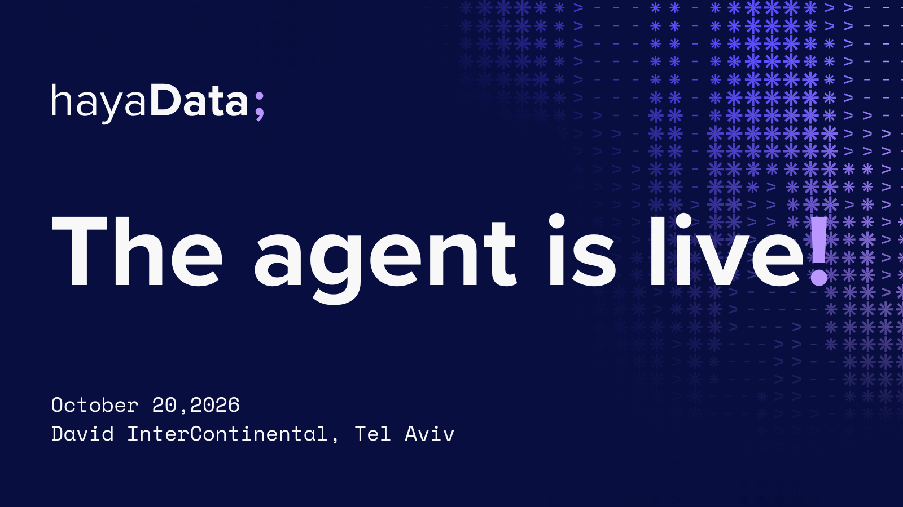

# Hayadata Conference Copilot (Claude skill)

An unofficial Claude skill for attendees of [hayaData 2026](https://haya-data.com/), the not-for-profit data community conference held on 20 October 2026 at the David InterContinental Hotel, Tel Aviv. It helps attendees find relevant talks, build a conflict-free personal agenda, and look up facts about sessions, speakers, food and menus, the Data & AI podcast schedule, and sponsors.

For the official program, tickets, and updates, always check the conference website: **https://haya-data.com/**

> This project is community-built and is not affiliated with or endorsed by the hayaData organizers.

## What it does

- Runs a short interview (one question at a time) and recommends 3 to 5 sessions ranked by fit.
- Builds a chronological agenda around the fixed breaks (10:35-11:00, 13:00-13:45, 15:15-15:30) and flags conflicts.
- Answers factual questions about sessions, speakers (with LinkedIn links), tracks, companies, and times, using only the bundled data.
- Knows the food and break schedule (breakfast, coffee breaks, lunch), the breakfast, 10:35 coffee break and lunch menus, and that sponsors give out swag during the breaks.
- Answers logistics questions: registration and entry, ticket transfers, the conference app, directions, parking, bicycles and scooters, kosher and food policy, the nursing room, emergency guidance, and the code of conduct.
- Lists the sponsors and community partners.
- Shares the recording schedules of the two podcasts recorded at the conference: Data & AI ("Talking with Mor Nitzan") and Data Bites.
- Opens every conversation with: "First of all - do you know how lucky you are to get a ticket?"
- Replies in the language the attendee uses.

All times are local conference time in Israel (Asia/Jerusalem).

## Example prompts

- "I'm a data engineer interested in streaming and AI agents. Which Hayadata talks should I see?"
- "I'll be at Hayadata from 13:45 to 16:00. Build me an agenda."
- "Who is speaking at the Track B session after lunch?"
- "Swap the 14:00 talk in my agenda for something on analytics."
- "What is for lunch, and is there a vegan option?"
- "When is the podcast recording on AI and data teams?"
- "Who are the sponsors, and when do they give out swag?"
- "Where can I park, and how do I get there by light rail?"
- "Can I give my ticket to a colleague?"
- "Where can I leave my scooter?"
- "Who is recorded for Data Bites before lunch?"
- "Give me the LinkedIn profile of the speaker on the graph database talk."

## Repository layout

```
hayadata-conference-copilot-skill/
├── README.md
├── LICENSE
├── assets/
│   └── hayadata-2026-save-the-date.png
├── .gitignore
├── .gitattributes
└── hayadata-conference-copilot/        <- the skill folder
    ├── SKILL.md                        <- required: frontmatter + instructions
    ├── Hayadata_Sessions.csv           <- 50 sessions
    ├── Hayadata_Speakers.csv           <- 57 speakers, with LinkedIn links
    ├── Hayadata_Podcast.csv            <- Data & AI and Data Bites podcast schedules
    ├── Hayadata_Info.md                <- logistics: registration, app, transport, parking, kosher, safety, code of conduct
    ├── Hayadata_Menu.csv               <- breakfast, 10:35 coffee break and lunch menus
    └── Hayadata_Sponsors.csv           <- sponsors and community partners
```

The skill is the `hayadata-conference-copilot/` folder. `SKILL.md` must stay at its root, and the folder name must match the `name` field in the frontmatter.

## Install

**Claude.ai:** zip the `hayadata-conference-copilot/` folder (or download the `.skill` file from Releases), then upload it under Settings > Capabilities > Skills.

**Claude Code:** copy the folder into `~/.claude/skills/` (personal) or `.claude/skills/` in a project.

## Package a `.skill` file

A `.skill` file is a zip of the skill folder:

```bash
zip -r hayadata-conference-copilot.skill hayadata-conference-copilot -x "*.DS_Store"
```

## Keeping the data current

The schedule can change before the event. If the program on [haya-data.com](https://haya-data.com/) differs from the bundled CSVs, update the files and re-package. Keep these columns:

- Sessions: `session_id, title, description, speakers, domain, talk_format, duration_minutes, track, start_time, end_time_calculated, schedule_note`
- Speakers: `speaker_name, tagline, bio, speaker_title, company, linkedin_url`
- Podcast: `podcast, start_time, end_time, format, title_he, title_en, guests, guest_titles, note`
- Menu: `meal, time, station, station_he, items, notes` (breakfast, the 10:35-11:00 coffee break and lunch have menus; the 15:15 coffee break does not yet)
- Sponsors: `name, type, website`

If counts, hours, or break times change, update `SKILL.md` to match (it mentions 50 sessions, 09:45 to 16:55, the fixed breaks, and the food schedule).

## Notes

- The CSVs use a UTF-8 BOM and CRLF line endings. `.gitattributes` stops git from rewriting them.
- The banner image is the official hayaData 2026 save-the-date artwork. It belongs to hayaData and is not covered by the MIT License.
- Session titles, descriptions, speaker bios, LinkedIn links, and the sponsor list come from the hayaData website and program and belong to the conference and its speakers. The podcast schedules come from the Data & AI and Data Bites conference lineups, the menus come from the conference catering menus, and the conference information comes from the hayaData website. The skill answers only from this data and does not invent sessions, speakers, or times.

## License

The skill instructions (`SKILL.md`) and this README are released under the [MIT License](LICENSE).

The MIT License does not cover the five CSV files, `Hayadata_Info.md`, or the banner image in `assets/`. Their content (session titles and descriptions, speaker names, bios and links, sponsor names, menus, the podcast lineup, the conference information, and the save-the-date artwork) comes from hayaData and remains the property of the conference and its speakers.
